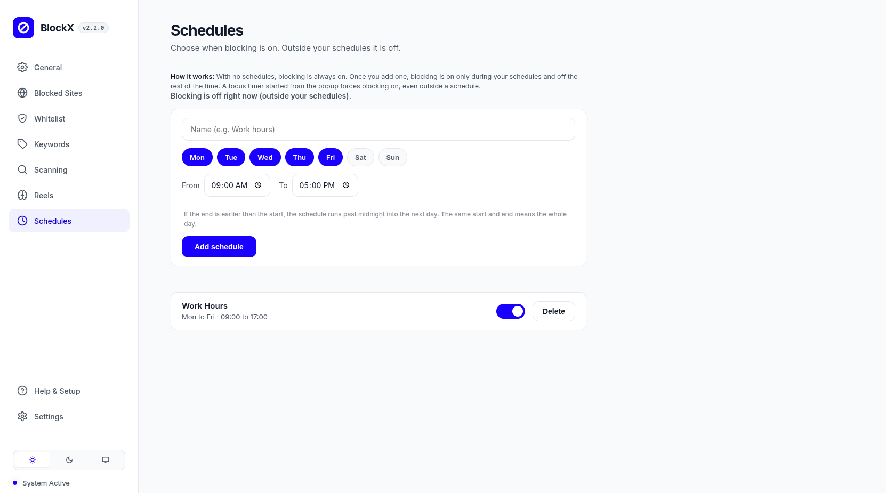
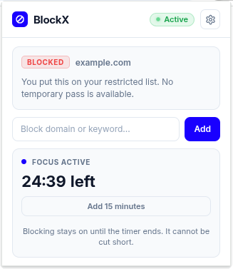

# BlockX v2.2

**A powerful, distraction-free content blocker built for discipline.**

---

> **This is a fork of [BlockX](https://github.com/CodesxTalha/BlockX) by Talha Khalid**, with the changes
> listed under [Changes in this fork](#changes-in-this-fork). The original design, code, and assets belong to the
> original author and stay under the original license. See [CREDITS.md](CREDITS.md).
> This fork was made with AI assistance: see [AI.md](AI.md) for details.

---

## Features

- **Modern Interface**  
  Clean, polished dashboard and toolbar popup with full Light Mode and Dark Mode support.

- **Quick Dashboard Shortcut**  
  Instant access to your dashboard from anywhere using the `Alt+S` keyboard shortcut with a quick toggle in Settings.

- **Dual Bypass Modes**  
  Choose between a two-step confirmation Warning Message or a word-for-word Retype Phrase challenge.

- **Unified Blocked Sites**  
  Manage entire domains, path prefixes (`/*`), and exact URLs in one unified place.

- **Granular Whitelist**  
  Whitelist a specific page (such as a single profile or video path) while automatically keeping the rest of the site blocked.

- **Scoped Keyword Filtering**  
  Add keywords with custom checking scopes (URL plus page content, or page only).

- **Robust Content Scanner**  
  Real-time on-page scanner with word-boundary matching to prevent false positives, plus a master toggle to turn scanning on or off.

- **Website Favicons & Offline Caching**  
  Display cached website icons across blocked destinations, whitelist, and scanning exclusions with local storage persistence, enabled via Settings.

- **Custom Calming Themes**  
  Four scientifically designed color palettes (Electric Blue, Boreal Pine, Nordic Slate, and Monochrome Slate) with matching dynamic favicons.

- **All-in-One Help & Setup**  
  One-click Chromium browser lockdown policy generator for Incognito, Guest mode, and extensions protection.

- **Password Protection & Backup**  
  Secure your settings with a dashboard password, with quick JSON backup export and import.

- **Schedules** *(added in this fork)*  
  Choose the days and hours when blocking is on. Outside your schedules blocking is off, and schedules can run past midnight.

- **Focus Timer** *(added in this fork)*  
  Start a 25, 45, or 60 minute (or custom) timer from the toolbar popup to force blocking on, even outside a schedule. It can be extended but not cut short.

- **Firefox Support** *(added in this fork)*  
  Runs in Firefox 128 or newer as well as Chromium browsers, including a Firefox version of the lockdown policy generator.

---

## Installation

1. Download or clone this repository.
2. Open `chrome://extensions` in any Chromium browser (Chrome, Brave, Edge).
3. Enable **Developer mode** using the toggle in the top right.
4. Click **Load unpacked** and select the BlockX directory.

**Firefox (128 or newer)**

1. Open `about:debugging#/runtime/this-firefox`.
2. Click **Load Temporary Add-on** and select `manifest.json` in the BlockX directory.
3. Open `about:addons`, select BlockX, and under Permissions allow access to your data for all websites.

Temporary add-ons are removed when Firefox closes. Release Firefox only keeps extensions that are signed, so a permanent install needs a signed `.xpi` file.

The dashboard opens automatically upon installation.

---

## Changes in this fork

These changes were tested by hand in Firefox and Vivaldi. See [AI.md](AI.md) for how AI assistance was used.

**Firefox support**

- The manifest declares a background `scripts` entry next to the service worker, a minimum Firefox version of 128, and that no data is collected.
- `moz-extension://` pages are exempt from blocking, the same way `chrome-extension://` pages already were.
- The dynamic rule limit falls back to the value Firefox supports.
- Firefox rejects redirects to `data:` addresses, which made the Discreet Null style fail and left old rules in place. In Firefox, Discreet Null now redirects to an empty page (`assets/blocked-pages/empty.html`). Chromium behavior is unchanged.
- The lockdown policy generator for Firefox now force-installs with `install_url` or locks an installed add-on with `Extensions.Locked`, and blocks safe mode when the extensions page is blocked.

**Schedules**

- New Schedules tab in the dashboard with days, start and end times, and an on/off switch for each schedule. With no schedules, blocking stays on all the time, as in the original.
- Blocking follows schedules in the background rules, the navigation checks, and the on-page script.
- Changes that reduce blocking time, such as adding the first schedule, deleting one, or switching one off, go through the existing bypass confirmation.

**Focus timer**

- New card in the toolbar popup. A running timer forces blocking on and can be extended but never shortened.

**Known limitations**

- Schedules are not yet included in settings backup, import, or sync.
- The Reels and Shorts check in the background script does not follow schedules yet.
- A page that is already open keeps its blocked or unblocked state until it is reloaded.

---

## Privacy First

BlockX does not collect, track, store, or transmit any data whatsoever.

- The extension runs entirely on your local machine.
- No analytics, no telemetry, and no tracking scripts.
- No external server connections. Everything stays completely on your side.

---

## Screenshots

### General Settings
Configure block enforcement behaviors, bypass verification modes, and your custom reflection prompts.

 

### Content Scanning
Manage keyword dictionaries with custom scopes (URL and page content, or page only) and toggle real-time DOM scanning.

 

### Granular Whitelist
Allow specific sections or single pages while keeping the rest of the domain blocked.

 

### On-Page Content Warning
Blocks explicit content in real time behind a overlay and requires your intention to proceed.

 

### Schedules
Choose the days and hours when blocking is on. Outside your schedules blocking is off, and a schedule can run past midnight.

 

### Focus Timer
Start a timer from the toolbar popup to force blocking on, even outside a schedule. It can be extended but not cut short.

 

### Theme Palettes & Sync Settings
Switch between calming accent themes and manage cross-device synchronization.

---

## License

[PolyForm Noncommercial License 1.0.0](https://polyformproject.org/licenses/noncommercial/1.0.0) (see [LICENSE](LICENSE)). Free for personal, noncommercial use.

This fork keeps the original license and the required copyright notice for Talha Khalid. The original project is at [CodesxTalha/BlockX](https://github.com/CodesxTalha/BlockX).
